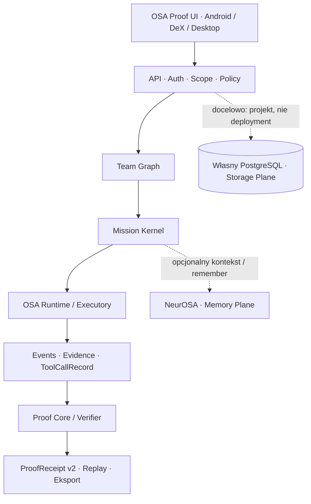

<div align="center">


# OSA PROOF

### Agenci wykonują. Zdarzenia zostają. Dowody rozstrzygają.

**CLAIM ≠ PROOF**

Framework do projektowania, wykonywania i audytowania systemów agentowych AI. Łączy **Team Graph → Mission Kernel → Runtime → Evidence → ProofReceipt → Replay**, aby oddzielać deklaracje modeli od weryfikowalnych zapisów wykonania.

**`Proof-first` · `TypeScript` · `Node.js` · `Agentic Runtime` · `Evidence` · `Fail-closed`**

[Panel OSA Proof](https://osa-proof-three.vercel.app/) · [Dokumentacja](./docs/README.md) · [Aktualny stan](./docs/STATUS_2026-11-03.md) · [Architektura](./docs/PERSISTENCE_ARCHITECTURE_V1_PROPOSAL.md) · [GitHub Actions](https://github.com/HazEOskA/osa-proof/actions)

</div>

> [!IMPORTANT]
> **Stan udokumentowany: 3 listopada 2026 · `main` @ `9aa81ab667a12b6ab38ff4d6bd61a1d7c52a41e6`.** Działa ścieżka generowania artefaktu z NVIDIA, eksportów Evidence/ProofReceipt i weryfikacji integralności dla zaobserwowanego wykonania. **To nie oznacza potwierdzonego produkcyjnego E2E dwóch rzeczywistych workerów, trwałej historii, izolowanego sandboxa ani wydania GA.** Aktualny werdykt w [raporcie statusu](./docs/STATUS_2026-11-03.md).

## Po co powstał OSA Proof?

Sam komunikat „zadanie wykonane” od agenta nie wystarcza. OSA Proof oddziela cztery warstwy:

| Warstwa | Odpowiedzialność | Co stanowi dowód? |
| --- | --- | --- |
| **Plan i uprawnienia** | Cel, Team Graph, wymogi i dopuszczalne executory | Jawne ID misji, wersja grafu i policy |
| **Egzekucja** | Misja, działania agentów, zdarzenia i handoff | Zdarzenia runtime, powiązane operacje i Evidence |
| **Proof** | Deterministyczna weryfikacja wymagań i integralności | `osa.proof_receipt.v2`, SHA-256, binding oraz werdykt |
| **Odbiór** | Eksport, audyt, Replay i decyzja operatora | Pakiet możliwy do sprawdzenia niezależnie od UI |

**`VERIFIED` potwierdza zakres zdefiniowanych wymagań i spójność zapisów — nie zastępuje audytu bezpieczeństwa, oceny merytorycznej ani dowodu niezależnego pochodzenia wszystkich informacji.**

## Co można sprawdzić już teraz?

| Funkcja | Stan na 03.11.2026 | Zakres |
| --- | --- | --- |
| **Team Graph + Mission Kernel** | **LOCAL TESTED / PARTIAL** | Wersjonowany graf, liniowe handoff, kontrakt misji i CAS w lokalnym MissionStore |
| **NVIDIA → artefakt HTML** | **OBSERVED / PROOF INTEGRITY PASS** | Zaobserwowany zapis generowania przez `openai/gpt-oss-20b`, zwrócony HTML, kontrola struktury i hashy |
| **APR / Evidence / ProofReceipt v2** | **INTEGRITY PASS dla eksportu** | Weryfikacja lokalna wskazanego przez operatora bundle, ProofReceipt, Evidence, trace i pliku HTML |
| **Replay offline** | **EXPORT AVAILABLE / CONSISTENT** | Odtwarza zapis zdarzeń, nie uruchamia modelu ani narzędzi ponownie |
| **Live Trace / SSE** | **IMPLEMENTED; LIVE ACCEPTANCE PARTIAL** | Rozmowa/artefakt z identyfikatorem wykonania; część śladów to metadane obserwacji przeglądarki |
| **NeurOSA** | **OBSERVED / DURABILITY UNKNOWN** | Dla badanego eksportu status pamięci `VERIFIED`; brak niezależnego restart-readback bieżącej usługi |
| **Durable Execution** | **LOCAL CODE / PRODUCTION BLOCKED** | Plikowy store i osobny worker dla zatwierdzonego hosta; Vercel nie spełnia warunków trwałości |
| **Dwa rzeczywiste workery + sandbox** | **NOT PROVEN** | W badanym eksporcie wykonawcy `demo.*`, `tool_calls = 0`; osobny E2E wymagany |
| **Trwała historia Team Graph / misji / czatów** | **GAP** | Brak wspólnego trwałego źródła prawdy; naprawa w planie |
| **Produkcyjne OAuth / pełne RBAC** | **ACCEPTANCE OPEN** | Zgłoszone `OAUTH_STATE_INVALID`; root cause nieustalony w tym audycie |

Szczegóły i precyzyjne źródła: [Status](./docs/STATUS_2026-11-03.md) · [Luki historii](./docs/HISTORY_AND_WORKSPACE_GAPS_2026-11-03.md) · [Jak czytać dowody](./docs/PROOF_EXPORTS_GUIDE.md).

## Architektura



**Źródła prawdy są rozdzielone:** Mission Kernel i Runtime prowadzą wykonanie; Proof Core weryfikuje zapisy; NeurOSA odpowiada za pamięć, a projektowany Storage Plane ma przechowywać trwały stan strukturalny. Nie tworzymy drugiego silnika agentów ani kopii pamięci NeurOSA.

```text
osa-proof/
├── api/                       # adapter Vercel
├── apps/
│   ├── api/src/               # HTTP, auth, NVIDIA, Mission API
│   ├── worker/                # wykonawcy / durable runner
│   └── web/                   # statyczne strony i assety
├── dashboard-src/             # UI React / TypeScript
├── packages/
│   ├── contracts/             # interfejsy i typy
│   ├── team-graph/            # graf agentów
│   ├── runtime/               # Mission Kernel i stores
│   ├── events/                # zdarzenia
│   ├── evidence/              # Evidence
│   ├── proof-core/            # canonical JSON / verifier
│   └── brain/                 # planowanie i memory adapter
├── scripts/                   # buildy i testy
├── tests/                     # testy automatyczne
└── docs/                      # dokumenty i historyczne dowody
```

## Szybki start — środowisko lokalne

Wymagane: **Node.js 20+**, npm oraz środowisko z powłoką POSIX (Bash/WSL), ponieważ obecny skrypt `build` wykorzystuje `rm -rf`. `OSA_AUTH_MODE=open` jest **wyłącznie do izolowanego testu lokalnego** — nie podawaj go jako publicznego serwera z danymi prywatnymi.

```bash
npm ci
npm test
node scripts/build-dashboard.cjs
OSA_EXECUTION_MODE=fixture OSA_AUTH_MODE=open npm start
```

API wystartuje domyślnie pod `http://localhost:3000` (nie jest to automatyczne uruchomienie osobnego deweloperskiego serwera dashboardu). Stan można odczytać w drugim terminalu:

```bash
curl http://localhost:3000/build/status
```

`npm test` obejmuje lokalny build i zestaw testów. **Samo uruchomienie serwera nie wytwarza ProofReceipt.** Historyczny wynik testów z 31 października (**305 PASS, 0 FAIL, 3 SKIP**) dotyczy wskazanego w [historycznym raporcie](./docs/OSA_PROOF_STATUS_2026-10-31.md) SHA, nie stanowi nowego wyniku CI dla bieżącego `main`.

## Proof i Replay — trzy różne typy materiałów

| Eksport | Zawartość | Czego **nie** dowodzi |
| --- | --- | --- |
| `osa.chat_delivery.v1` | Bundle z `record`, `run`, artefaktem, Evidence i Proof | Że wykonały go faktycznie niezależne workery, jeżeli użyto executorów `demo.*` |
| `osa.mission.v1` | Zapis misji z Mission Kernel, jej stan i receipt | Że wszystkie zewnętrzne integracje/side effects zostały niezależnie poświadczone |
| `osa.live_execution.v1` + `osa.live_metadata.v1` | Zdarzenia i metadane obserwowane w Live UI | Kryptograficznego APR ProofReceipt, jeśli takiego nie dołączono |

**Ważny test z 3 listopada:** w przekazanym prywatnie eksporcie ChatDelivery odnotowano **65 zdarzeń timeline, 47 zdarzeń Runtime, 13 Evidence, 27 verifier observations i 10 rozpoczętych ról**. Zewnętrznie sprawdzone hashe bundle, receipt, Evidence i artefaktu były zgodne; **`tool_calls = 0`**, więc nie jest to test rzeczywistych narzędzi dwóch workerów. Identyfikatory i zawartość prywatnego pakietu nie są publikowane w repo. [Przewodnik weryfikacji](./docs/PROOF_EXPORTS_GUIDE.md).

## Znane ograniczenia i roadmapa

**P0 — trwałość i odnajdywanie pracy:** Team Graph i Build workspace są zapisywane lokalnie albo w pamięci instancji API; Studio nie oferuje katalogu dawnych misji; historia czatów w IndexedDB nie jest sortowana po `updated`. Szczegóły i kryteria odbioru: [Rejestr luk](./docs/HISTORY_AND_WORKSPACE_GAPS_2026-11-03.md).

**P0 — własny storage, host jeszcze niewybrany:** provider-neutral adapter do **PostgreSQL** jest **propozycją architektoniczną**, nie utworzoną bazą ani planem deployu. Do czasu potwierdzenia hosta i osobnej zgody pozostaje `BLOCKED`. [Architektura Storage v1](./docs/PERSISTENCE_ARCHITECTURE_V1_PROPOSAL.md).

**P0/P1 — bezpieczeństwo i rzeczywiste E2E:** produkcyjny scope/RBAC, kontrola OAuth, trwały worker, kontrolowany egress, autentyczność źródła dowodów oraz end-to-end przez dwóch realnych workerów wymagają oddzielnych testów. `egress_status: NOT_ENFORCED`; `signature_status: UNAVAILABLE`.

> [!CAUTION]
> Status `VERIFIED` w lokalnym ProofReceipt **nie** jest podpisem kryptograficznym niezależnego źródła ani certyfikatem gotowości do produkcji. Nie umieszczaj sekretów ani danych klientów w środowisku z `OSA_AUTH_MODE=open`.

## Dokumentacja i referencje

| Kategoria | Dokument |
| --- | --- |
| Indeks dokumentacji | [docs/README.md](./docs/README.md) |
| Stan na 03.11.2026 | [STATUS_2026-11-03](./docs/STATUS_2026-11-03.md) |
| Priorytetowe usterki | [HISTORY_AND_WORKSPACE_GAPS](./docs/HISTORY_AND_WORKSPACE_GAPS_2026-11-03.md) |
| Trwały magazyn — projekt | [PERSISTENCE_ARCHITECTURE_V1](./docs/PERSISTENCE_ARCHITECTURE_V1_PROPOSAL.md) |
| Eksporty i audyt | [PROOF_EXPORTS_GUIDE](./docs/PROOF_EXPORTS_GUIDE.md) |
| Kontrakty | [Team Graph](./docs/TEAM_GRAPH_CONTRACT_V1.md) · [Mission Kernel](./docs/MISSION_KERNEL_V1.md) · [Proof Protocol v2](./docs/PROOF_PROTOCOL_V2.md) |
| Bezpieczeństwo i provenance | [Attribution Gate](./docs/ATTRIBUTION_GATE_V1.md) · [Security Verdict](./docs/final-boss/SECURITY_VERDICT.md) |
| Live i durable | [Live Trace](./docs/P0_UNIFIED_LIVE_TRACE_20261103.md) · [Durable Execution](./docs/P0_DURABLE_EXECUTION_20261103.md) |
| Raporty historyczne | [31.10](./docs/OSA_PROOF_STATUS_2026-10-31.md) · [Preview 28.10](./docs/OSA_PROOF_PREVIEW_STATUS_2026-10-28.md) |

## Status rozwoju i governance

Projekt jest rozwijany w trybie **proof-first, preview-first, fail-closed**. Zmiany kodu, migracje, commity, merge i produkcyjne wdrożenia wymagają osobnego zatwierdzenia zakresu. Wersja pakietu `0.1.0` jest oznaczeniem kodu, **nie deklaracją wydanej, w pełni zweryfikowanej usługi enterprise**. Wydanie GA jest `BLOCKED` do zamknięcia bramek.

<div align="center">

**OSA / AGENTS RUN. EVENTS STAY. PROOF DECIDES.**

</div>
