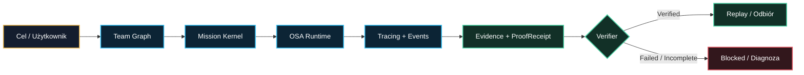
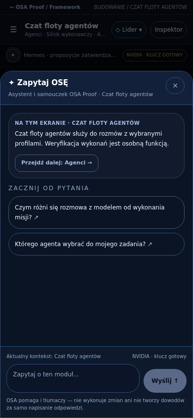
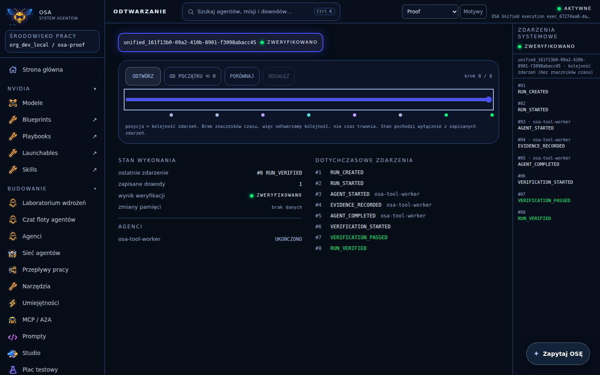

<p align="center">
  
</p>

<h1 align="center">OSA PROOF</h1>

<p align="center"><strong>Agent Runtime · Control Plane · Evidence & Verification</strong></p>

<p align="center">
  Jeden framework do budowania i uruchamiania systemów agentowych AI — z dowodami, których nie zastąpi deklaracja modelu.
</p>

<p align="center">
  <a href="https://github.com/HazEOskA/osa-proof/pull/16"></a>
  <a href="https://github.com/HazEOskA/osa-proof/actions/workflows/osa-fleet-slice1-ci.yml?query=branch%3Arelease%2Fosa-proof-v0.1.0"></a>
  <a href="./docs/release-v0.1.0/WERYFIKACJA.md"></a>
</p>

<p align="center"><code>TEAM GRAPH</code> · <code>AGENTS</code> · <code>RUNTIME</code> · <code>TRACING</code> · <code>PROOF</code> · <code>REPLAY</code></p>

> **CLAIM ≠ PROOF.** Agent nie kończy pracy dlatego, że napisał „gotowe”. O zakończeniu decydują zarejestrowane wykonanie, materiał dowodowy oraz weryfikacja `ProofReceipt`.

**Status:** `v0.1.0` pozostaje **kandydatem (BLOCKED)**, bez tagu i GitHub Release. Istnieje wdrożenie aplikacji pod [stałym adresem odbioru](https://osa-proof-three.vercel.app), ale jego `READY` nie oznacza zaliczenia pełnego modelowego E2E ani trwałości cloud. [Bramki wydania](./docs/release-v0.1.0/BRAMKI.md) · [Aktualny audyt](./docs/release-v0.1.0/AUDYT_DODATKOWY_2026-10-17.md).

---

## ⚡ System w jednym spojrzeniu



**WHAT:** infrastruktura do budowania, obserwowania i weryfikowania przepływów agentowych.  
**CONNECTS:** agenci, modele, Team Graph, misje, Runtime, zdarzenia i dowody w jednym kontrakcie.  
**EDGE:** `ProofReceipt`, niezależny verifier oraz jawna granica między **odpowiedzią AI** a **potwierdzonym wykonaniem**.

## Dlaczego to istnieje?

Sam tekst wygenerowany przez LLM nie odpowiada na najważniejsze pytania: **który agent wykonał pracę, jakim narzędziem, według jakiej polityki i gdzie jest dowód?** OSA Proof spina warstwę wykonawczą z obserwowalnością oraz deterministyczną weryfikacją. Model może proponować. Runtime wykonuje. **Verifier rozstrzyga zakres dowodu.**

Nie jest to pojedynczy APR ani kolejny samodzielny chatbot. To kanoniczne repo całego frameworka, którego moduły współdzielą architekturę i konwencje dowodowe.

## 🐝 Jeden ekosystem, wiele warstw

| Warstwa | Funkcja | Kod / dokumentacja | Status obecnego zakresu |
| :--- | :--- | :--- | :--- |
| **Team Graph / Agenci** | Role, executor refs, wersjonowany graf i handoff | [team-graph](./packages/team-graph), [kontrakt](./docs/TEAM_GRAPH_CONTRACT_V1.md) | **VERIFIED** — lokalne kontrakty i wykonanie |
| **Mission Kernel + Runtime** | Planowanie, polityki, egzekucja i przebieg misji | [runtime](./packages/runtime), [misje](./docs/MISSION_KERNEL_V1.md) | **VERIFIED** — natywny przepływ lokalny |
| **Czat floty + NVIDIA** | Profile agentów, historia, odpowiedzi providera, ograniczone `tool_calls` | [API](./apps/api/src/nvidia.ts), [most](./docs/NVIDIA_BRIDGE.md) | **PARTIAL** — modelowy cloud E2E niezaliczony |
| **Zapytaj OSĘ** | Globalny, kontekstowy samouczek i nawigacja po UI | [panel](./dashboard-src/src/views/OsaHelpDock.tsx) | **PARTIAL** — test UI, model live nieweryfikowany |
| **Evidence / Proof / Replay** | Weryfikacja bundle, integrality check, odtworzenie zapisanych zdarzeń | [proof-core](./packages/proof-core), [protokół](./docs/PROOF_PROTOCOL_V2.md) | **VERIFIED** dla natywnego lokalnego wykonania |
| **Builder / Worker Host** | Narzędzia budowania i izolowane wykonanie | [worker](./apps/worker), [kontrakt](./docs/OSA_WORKER_HOST_V0.1.md) | **GATED** — brak dowodu live sandbox |
| **NeurOSA / Memory** | Opcjonalny kontekst pamięci i planowania | [Brain](./packages/brain), [S2](./docs/NEUROSA_BRAIN_S2.md) | **GATED** — brak live recall i trwałości |
| **Web3 / Regulated** | Obserwacje i zasady uprawnień | [Web3](./packages/web3), [warstwy](./docs/LAYER_BOUNDARIES.md) | **PARTIAL / GATED** — bez swobodnych mutacji |

Szczegółowe kryteria i ograniczenia: **[macierz możliwości v0.1.0](./docs/release-v0.1.0/MACIERZ.md)**. Implementacja lub widoczna zakładka nie wystarczają do nadania statusu VERIFIED.

### Trzy profile produktu, jeden Core

```text
OSA ACADEMY / SCHOOL    →  nauka i kontrolowany zakres funkcji
OSA BUILDER / DEV       →  podstawowy agentic runtime + control plane
OSA REGULATED           →  bramki dla środowisk wymagających uprawnień
                               ↳ WSPÓLNY CORE / KONTRAKTY / PROOF
```

Regulated pozostaje zamknięte bez odpowiednich uprawnień. Nie ma osobnego frameworka ani „drugiego mózgu”.

---

## 🗺️ Mapa repo

```text
osa-proof/
├── api/                     # jedno wejście Vercel API
├── apps/
│   ├── api/src/             # HTTP, auth, model bridge, dispatch
│   ├── worker/              # host izolowanych zadań (gated)
│   └── web/                 # web + istniejący brand OSA Frameworks
├── dashboard-src/           # polski control plane, flota, przewodnik, replay
├── packages/
│   ├── contracts/           # wspólne kontrakty i typy
│   ├── team-graph/          # graf i walidacja
│   ├── runtime/             # misje i egzekucja
│   ├── brain/               # planowanie i opcjonalny context
│   ├── adapters/            # modele i integracje
│   ├── events/              # zdarzenia
│   ├── evidence/            # dowody
│   └── proof-core/          # digest + weryfikacja
├── tests/                   # testy kontraktowe i negatywne
├── scripts/                 # build i testy przeglądarkowe
└── docs/                    # kontrakty, release gate, evidence i runbook
```

Wszystkie widoczne obszary działają na istniejących kontraktach. Nie dokładaj osobnego control plane.

## 🧪 Uruchomienie lokalne

**Node.js 20+**, npm. Tryb offline/fixture; **bez kluczy modeli i bez płatnych wywołań**.

```bash
npm ci
npm test
npm run worker:build
node scripts/build-dashboard.cjs
OSA_EXECUTION_MODE=fixture OSA_AUTH_MODE=open npm start
```

`OSA_EXECUTION_MODE=fixture` wykonuje deterministyczne testowe ścieżki — nie jest dowodem pracy modelu ani izolowanego workera. `provider` wymaga osobnej, bezpiecznej konfiguracji. [Instrukcja operatora](./docs/release-v0.1.0/OPERATOR.md) · [Model bridge](./docs/NVIDIA_BRIDGE.md).

## 🔐 Granica zaufania

| Działanie | Zasada |
| :--- | :--- |
| **Otwarty panel** (`OSA_AUTH_MODE=open`) | Wyłącznie publiczne dane demonstracyjne; współdzielony stan, **brak izolacji użytkowników** |
| **Wywołania NVIDIA** | Osobna sesja operatora, serwerowy klucz, dokładny origin i bramka kosztów |
| **Narzędzia modelu** | Tylko allowlistowany odczytowy SHA-256; brak dowolnego dispatchu |
| **Trwałość danych** | `PROCESS_MEMORY` i `localStorage` **nie są** trwałym magazynem serverless |
| **Sekrety i prywatne eksporty** | Nie zapisuj ich do otwartego panelu, README, logów, screenshotów ani repo |
| **Cloud deploy i mutacje** | Jawna autoryzacja, fail-closed; sam opis możliwości nie oznacza aktywacji |

**Uwaga:** w publicznym odbiorowym `OPEN_PRODUCTION` część innych tras nadal operuje na wspólnym stanie. Ochrona NVIDIA nie stanowi pełnego zabezpieczenia wszystkich zapisów. Szczegóły: [audyt dodatkowy](./docs/release-v0.1.0/AUDYT_DODATKOWY_2026-10-17.md).

## ✅ Proof zamiast deklaracji

| Kontrola | Wynik i zakres | Evidence |
| :--- | :--- | :--- |
| Testy / build na kandydacie | CI **3/3 SUCCESS** na `4c375e8`; nie są to testy live providera | [CI](https://github.com/HazEOskA/osa-proof/actions/runs/38985293601) · [Browser](https://github.com/HazEOskA/osa-proof/actions/runs/38985293682) · [HTTP/SSE](https://github.com/HazEOskA/osa-proof/actions/runs/38985293598) |
| Natywny Runtime → receipt → Replay | **PASS** w kontrolowanych testach 320/390/1440 px | [Weryfikacja / execution_id](./docs/release-v0.1.0/WERYFIKACJA.md) |
| Zmodyfikowany bundle / nieautoryzowane narzędzia | **Odrzucenie sprawdzone w testach** | [Dowody](./docs/evidence/release-v0.1.0) |
| Rzeczywiste NVIDIA `tool_calls` → Proof | **NOT VERIFIED / BLOCKED** | Brak zatwierdzonej sesji live i nowego cloud `execution_id` |
| Redis quota na dwóch instancjach | **NOT VERIFIED** | Brak dowodu użycia realnej usługi |
| Durable cloud state / odczyt po restarcie | **BLOCKED** | `PROCESS_MEMORY` nie spełnia warunku |
| GitHub Release `v0.1.0` | **NOT RELEASED** | [Bramki](./docs/release-v0.1.0/BRAMKI.md) |

**ProofReceipt potwierdza określoną integralność i przebieg wykonania w zaufanym procesie. Nie jest kryptograficznym certyfikatem NVIDIA ani dowodem prawdziwości całej treści wygenerowanej przez AI.**

---

## 🖥️ OSA w praktyce

<p align="center">
  
  &nbsp;
  
</p>

<sub>Zrzuty z testów — ich zakres opisano w [WERYFIKACJA.md](./docs/release-v0.1.0/WERYFIKACJA.md). Nie są demonstracją prawdziwego tool-call modelu.</sub>

## 📚 Dokumentacja i następny checkpoint

**[Indeks wszystkich docs](./docs/README.md)** · [Architektura](./docs/BACKEND_ARCHITECTURE_LOCK_V1.md) · [Runtime](./docs/OSA_UNIFIED_RUNTIME_V1.md) · [Proof V2](./docs/PROOF_PROTOCOL_V2.md) · [Release candidate](./docs/release-v0.1.0/BRAMKI.md) · [Changelog](./CHANGELOG.md)

Aby zamknąć `v0.1.0`: oddzielić publiczne demo od prywatnych danych, potwierdzić bezpłatny model NVIDIA, atomowy limit Redis, pełny prawdziwy przepływ model → Runtime → Proof oraz trwałość serverless. **Nie tworzyć kolejnego repo, osobnego dashboardu ani nowego frameworka.**

## Identyfikacja OSA

<p align="center">
  
</p>

Identyfikacja korzysta z **istniejącego** brandu OSA Frameworks: czerni, złota, błękitnej energii i muskularnej osy. [Manifest tożsamości](./docs/assets/identity.json) dokumentuje rzeczywiste ścieżki. Obecny banner jest `WEBP`; kanoniczny eksport `hero-banner.png` 16:9 i `logo-square.png` 1:1 wg `osa-readme-forge V3` nadal wymaga osobnego, rzeczywistego zapisu PNG i **nie jest oznaczany jako wykonany**. Nie podmieniaj maskotki na obcego generycznego robota.

---

<p align="center">
<code>OSA / AGENTS RUN. EVENTS STAY. PROOF DECIDES.</code>
</p>

```text
  ░█▀█░█▀▀░█▀█░  /  OSA PROOF
  ░█░█░▀▀█░█▀█░
  ░▀▀▀░▀▀▀░▀░▀░  CLAIM != PROOF

  NO RECEIPT. NO DONE.
```

<p align="center"><sub>OSA ecosystem · Bartosz „Osa” Osiński · <a href="https://github.com/HazEOskA/osa-proof">HazEOskA/osa-proof</a></sub></p>
