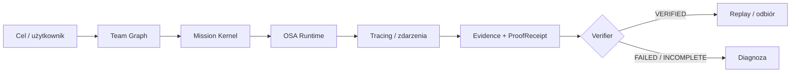

# OSA PROOF

**Agent powiedział „gotowe”. OSA Proof sprawdza, czy są na to dowody.**

Framework do budowania, uruchamiania i weryfikowania systemów agentowych AI. Łączy `Team Graph`, misje, Runtime, zdarzenia, `Evidence` i `ProofReceipt` — tak, aby dało się sprawdzić **co rzeczywiście zostało wykonane**, a nie tylko co odpowiedział model.

**CLAIM ≠ PROOF** · `AGENTS` · `RUNTIME` · `TRACING` · `VERIFICATION` · `REPLAY`

> **Integracja NeurOSA × OSA Proof (2026-10-27):** ChatDelivery ma kod serwerowego `recall → NVIDIA → Runtime/Proof → VERIFIED_RUNTIME memory receipt` oraz bramkę prywatnego dostępu GitHub; CI 265 PASS / 0 FAIL / 3 SKIP. Railway volume `neurosa-memory-v1` jest zamontowany pod `/persist`; backup `brain-restore.db` ma potwierdzony SHA-256 i integralność SQLite, ale **Brain API nadal nie zostało przełączone na trwałą bazę ani potwierdzone po restarcie**. Brakuje też produkcyjnego OAuth. Prywatny scenariusz testowy Hermesa nie jest funkcją produktu ani publicznym elementem dokumentacji. [Plan odbioru](./docs/NEUROSA_LIVE_ACCEPTANCE_2026-10-26.md). **CLAIM ≠ PROOF; bez deklaracji LIVE PASS.**

> **Status v0.1.0: kandydat — BLOCKED.** Lokalne testy działają w trybie `fixture` bez kluczy i płatnych wywołań. Do formalnego wydania brakuje potwierdzonego NVIDIA `tool_calls` → Runtime → Proof, rzeczywistego współdzielonego limitu Redis, trwałości chmurowej i bezpiecznej granicy danych w otwartym demo. Produkcyjne wdrożenie panelu istnieje, ale `READY` ≠ pełne E2E ani GitHub Release. **[Bramki wydania](https://github.com/HazEOskA/osa-proof/blob/release/osa-proof-v0.1.0/docs/release-v0.1.0/BRAMKI.md) · [Audyt](https://github.com/HazEOskA/osa-proof/blob/release/osa-proof-v0.1.0/docs/release-v0.1.0/AUDYT_DODATKOWY_2026-10-17.md) · [PR #16](https://github.com/HazEOskA/osa-proof/pull/16)**

## ⚡ Zobacz, że działa — lokalnie

Wymagania: Node.js **20+**, npm. Wykonaj w katalogu repo:

```bash
npm ci
npm test
npm run build
node scripts/build-dashboard.cjs
OSA_EXECUTION_MODE=fixture OSA_AUTH_MODE=open npm start
```

**Co zobaczysz?** Uruchomi się **API** na `http://localhost:3000`, nie osobny serwer dashboardu. Terminal wypisze JSON z `"service":"osa-proof-api"`, `"mode":"fixture"`, `"auth_mode":"open"` i `"port":3000`. W drugim terminalu możesz sprawdzić odpowiedź:

```bash
curl http://localhost:3000/build/status
```

Oczekuj m.in. informacji o `mode: "fixture"`, executorach i rodzaju przechowywania stanu. `npm test` uruchamia testy; samo `npm start` **nie tworzy automatycznie nowego ProofReceipt**. Przykładowy, istniejący dowód pochodzi z osobnego lokalnego testu natywnego Runtime:

```json
{
  "schema": "osa.proof_receipt.v2",
  "execution_id": "exec_6927de50-2ced-436b-97c1-13784263530b",
  "verdict": "VERIFIED",
  "verifier": {
    "name": "osa-proof-deterministic",
    "version": "2"
  },
  "receipt_sha256": "a127c4b672efe8f5272dd380c969524f2ee0d7721a91ff58f83d861f45bddb4f"
}
```

*To wybrane pola istniejącego `run.proof`, nie kompletna struktura ani wynik samego `npm start`.* **[Pełny bundle (team → mission → run → evidence → proof)](https://github.com/HazEOskA/osa-proof/blob/release/osa-proof-v0.1.0/docs/evidence/release-v0.1.0/preview-open-desktop-bundle.json)** · [opis testu](https://github.com/HazEOskA/osa-proof/blob/release/osa-proof-v0.1.0/docs/release-v0.1.0/WERYFIKACJA.md). Jest to natywny fixture SHA-256, **nie wynik prawdziwego NVIDIA `tool_calls`**.

## Dla kogo?

Dla **zespołów i architektów budujących agentów AI**, którzy muszą wiedzieć, **który agent uruchomił jakie narzędzie, jakie zdarzenia zaszły i czy dowody wyniku przechodzą niezależną weryfikację**.

<p align="center">
  
</p>

<details>
<summary><strong>🇬🇧 English — overview, quickstart and sample proof</strong></summary>

# OSA PROOF

**An agent said “done”. OSA Proof checks whether there is evidence.**

A framework for building, running and verifying AI agent systems: connecting Team Graph, missions, Runtime, events, evidence and verifiable `ProofReceipt` artifacts.

> **v0.1.0: release candidate — BLOCKED.** Local fixture-mode tests work without API keys or paid model calls. Release gates still require a real NVIDIA `tool_calls` → Runtime → Proof flow, a shared Redis quota, cloud persistence and a safe boundary between public demo data and protected information. A `READY` deployment is not a released product. [Release gates](https://github.com/HazEOskA/osa-proof/blob/release/osa-proof-v0.1.0/docs/release-v0.1.0/BRAMKI.md) · [Audit](https://github.com/HazEOskA/osa-proof/blob/release/osa-proof-v0.1.0/docs/release-v0.1.0/AUDYT_DODATKOWY_2026-10-17.md).

### See it run — locally

Requires Node.js 20+ and npm.

```bash
npm ci
npm test
npm run build
node scripts/build-dashboard.cjs
OSA_EXECUTION_MODE=fixture OSA_AUTH_MODE=open npm start
```

**Expected result:** a local **API server**, not an automatically served dashboard, starts at `http://localhost:3000` and logs `"service":"osa-proof-api"`, `"mode":"fixture"` and `"port":3000`. Inspect it with:

```bash
curl http://localhost:3000/build/status
```

The fixture-mode receipt excerpt shown above was taken from a **real local native-runtime test**, not from `npm start` and not from a live NVIDIA model. [Full sample ProofReceipt in its evidence bundle](https://github.com/HazEOskA/osa-proof/blob/release/osa-proof-v0.1.0/docs/evidence/release-v0.1.0/preview-open-desktop-bundle.json).

### Who is it for?

**AI agent engineering teams and system architects** who need an auditable record of which agent ran which tool, what happened and whether execution evidence passes verification.

</details>

---

## Architektura w jednym widoku



OSA Proof to **cały ekosystem**, nie tylko APR. Model, wykonawca i verifier mają odrębne zadania. Sam `ProofReceipt` świadczy o zakresie i integralności zarejestrowanych dowodów, **nie** o semantycznej prawdziwości dowolnego stwierdzenia AI.

## Moduły i ich rzeczywisty status

| Moduł | Rola w systemie | Granica dowodu |
| --- | --- | --- |
| **Team Graph / Mission Kernel** | Agenci, wersje, przekazania i cykl misji | Zaimplementowane i testowane lokalnie |
| **OSA Runtime / Tracing** | Wykonanie i zapis zdarzeń | Natywne testy lokalne PASS |
| **Evidence / ProofReceipt / Replay** | Materiał dowodowy, weryfikacja, odtwarzanie zdarzeń | Zweryfikowany natywny przepływ; cloud persistence niepotwierdzona |
| **Czat floty agentów / NVIDIA** | Modele, profile, rozmowa i ograniczone narzędzia | Live modelowe `tool_calls` E2E nadal BLOCKED |
| **Zapytaj OSĘ** | Kontekstowy samouczek po całym frameworku | UI/kontrakt testowany; realne odpowiedzi guide wymagają osobnego testu |
| **Builder / Worker Host** | Projektowanie zadań, narzędzi i izolowany wykonawca | Uruchomienie pełnego sandboxa w chmurze GATED |
| **NeurOSA / Memory** | Opcjonalny kontekst pamięci i planowanie | Trwały live recall niepotwierdzony |
| **Web3 / Regulated** | Odczyt, zasady ryzyka, bramki dostępu | Brak domyślnych uprawnień do podpisywania i mutacji |

Wszystkie statusy dotyczą wskazanego zakresu testów, nie gwarancji enterprise. **[Macierz funkcji kandydata v0.1.0](https://github.com/HazEOskA/osa-proof/blob/release/osa-proof-v0.1.0/docs/release-v0.1.0/MACIERZ.md)**.

### Jedno repozytorium, wspólny Core

```text
osa-proof/
├── api/                     # entrypoint Vercel
├── apps/
│   ├── api/src/             # HTTP, auth, NVIDIA, wykonanie
│   ├── worker/              # worker host
│   └── web/                 # web i identyfikacja OSA
├── dashboard-src/           # polski framework UI i flota agentów
├── packages/
│   ├── team-graph/          # graf zespołu
│   ├── contracts/           # typy i kontrakty
│   ├── runtime/             # silnik wykonawczy
│   ├── events/              # zdarzenia
│   ├── evidence/            # materiał dowodowy
│   ├── proof-core/          # verifier i receipt
│   └── brain/               # planowanie i opcjonalna pamięć
├── scripts/                 # build i testy E2E
├── tests/                   # testy automatyczne
└── docs/                    # architektura i proof protocols
```

## Security gate i ograniczenia

**Otwarty panel nie jest prywatnym środowiskiem produkcyjnym.** `OSA_AUTH_MODE=open` umożliwia anonimowy dostęp do części API i współdzielonej przestrzeni demonstracyjnej. Nie wprowadzaj tam danych klientów, prywatnych eksportów ChatGPT ani sekretów. NVIDIA jest osobno chroniona sesją operatora i polityką kosztową, ale nie oznacza to pełnego RBAC całego API.

`PROCESS_MEMORY` oraz lokalna historia przeglądarki **nie** zapewniają trwałości w chmurze ani izolacji wielu użytkowników. Integracje wymagające prawdziwego modelu, Redis, workera i NeurOSA podlegają odrębnym bramkom.

## Dowody, CI i dokumentacja

- [Proof Protocol V2](./docs/PROOF_PROTOCOL_V2.md) · [Team Graph](./docs/TEAM_GRAPH_CONTRACT_V1.md) · [Mission Kernel](./docs/MISSION_KERNEL_V1.md) · [NVIDIA Bridge](./docs/NVIDIA_BRIDGE.md).
- [Zarejestrowane testy wydania](https://github.com/HazEOskA/osa-proof/blob/release/osa-proof-v0.1.0/docs/release-v0.1.0/WERYFIKACJA.md) — rozróżniają natywny Runtime od symulowanego transportu modeli.
- [GitHub Actions](https://github.com/HazEOskA/osa-proof/actions) · [PR #16 — kandydat v0.1.0](https://github.com/HazEOskA/osa-proof/pull/16).

**v0.1.0 będzie wydane dopiero po zamknięciu bramek i osobnym merge/tag/Release.** Aktualizacja samego README na `main` nie jest publikacją oprogramowania.

<p align="center">
  
</p>

<p align="center"><strong>OSA / AGENTS RUN. EVENTS STAY. PROOF DECIDES.</strong></p>
