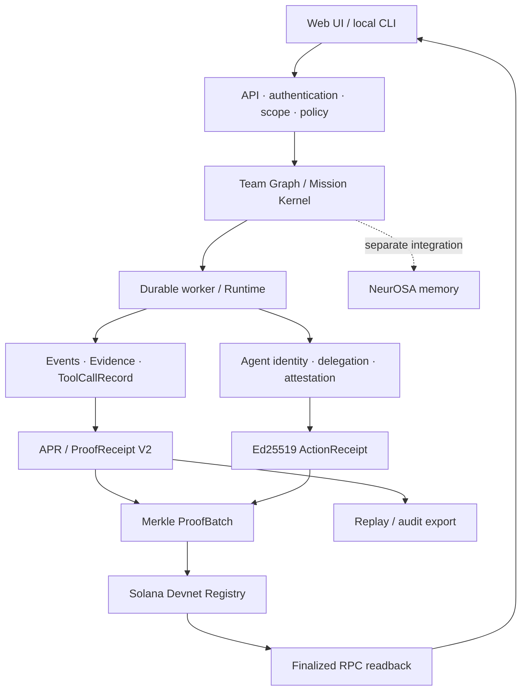

<div align="center">


# OSA PROOF

### Verifiable AI agent execution infrastructure

**CLAIM ≠ PROOF**

A proof-first framework that connects agent orchestration, execution evidence, deterministic verification, cryptographically signed action receipts and independently readable blockchain commitments.

**TypeScript · Node.js · Durable Runtime · Ed25519 · Merkle ProofBatch · Solana Devnet**

[Live application](https://osa-proof-three.vercel.app/) · [Developer documentation](https://osa-proof-three.vercel.app/docs) · [Technical index](./docs/README.md) · [Execution evidence](./docs/STATUS_2026-11-27.md) · [CI](https://github.com/HazEOskA/osa-proof/actions) · [Portfolio](https://osatechgpt.dev)

</div>

> [!IMPORTANT]
> **2026-11-27 — two actual signed agent chat executions verified end to end against the deployed OSA Proof Registry on Solana Devnet.** A separate verification invocation checked both stored jobs, signatures, execution binding, Merkle inclusions and finalized on-chain accounts. This is a demonstrated single-operator integration, not Mainnet, an independent security audit or enterprise GA.

## Why OSA Proof?

An agent saying that a task is complete does not establish that it was performed. OSA Proof makes the evidence path explicit: what was requested, which execution produced a result, which recorded requirements passed, which key signed an action receipt and which commitment was finalized.

| Layer | Responsibility |
| --- | --- |
| Team Graph / Mission Kernel | Canonical team topology, mission lifecycle, scope and requirements |
| Runtime / Durable worker | Execute configured agents and persist task state independently of the browser |
| Evidence / APR verifier | Bind observations, tool records and output to a deterministic ProofReceipt V2 |
| Agent Trust Fabric | Signed delegation, runtime attestation and causal Ed25519 ActionReceipts |
| Merkle ProofBatch / Registry | Commit both receipt digests and read finalized state from Solana Devnet |
| UI / Replay / exports | Inspect recorded execution, download proof materials and distinguish claims from evidence |

## Demonstrated execution evidence

| Run | Execution | Public chain reference | Finalized slot |
| --- | --- | --- | --- |
| 1 | `exec_467870c6-ee5d-4344-842d-003b063d65a1` | [Finalized transaction](https://explorer.solana.com/tx/27ArGoAkr848ZfZM7qQvh7oev9cLtnNiZjQeyagzj89UG9iUNRJaiwbRPMdiSypCfkMW6jZzKZDctphd2KhUnn9s?cluster=devnet) | 526953298 |
| 2 | `exec_1b59d635-77a2-4c24-9c04-74ac21920ebb` | [Finalized transaction](https://explorer.solana.com/tx/2jfJLMfHDoVeP5eeKBCg2WLELeMfdvpj1Gm3M1b2bfpBk51DNEF3jn32E5GZGpCExDKFLDTJSKQ2hmuSd93QYNoS?cluster=devnet) | 526956144 |

[Registry program on Devnet](https://explorer.solana.com/address/6QTgaWY6SyZsjCiuY9BGMn5H7PzoFghCocwkbKxxmG8p?cluster=devnet) · [Verification results and boundaries](./docs/STATUS_2026-11-27.md) · [Registry protocol](./docs/PROOF_REGISTRY_DEVNET.md).

The two runs used the persistent Jeverson worker and Ollama `qwen2.5:3b`. Proof integrity, Ed25519 signature, pinned public key, signed software attestation, recomputed batch, both inclusion proofs, input/output binding and finalized RPC readback passed for both. The public chain references expose commitments, not private conversation content.

## Architecture



The Vercel application routes authorized Durable requests to a dedicated HTTPS bridge on the persistent worker host; it does not execute durable jobs in a serverless function. The Registry stores commitments, not model inference or conversation text. The existing ProofReceipt V2 schema is unchanged; the signed ActionReceipt and Merkle batch extend it.

## Get started locally

Requirements: Node.js 20+ and npm. The deterministic fixture mode requires no external model key.

```bash
git clone https://github.com/HazEOskA/osa-proof.git
cd osa-proof
npm ci
npm test
node scripts/build-dashboard.cjs
```

Start the local CLI:

```bash
node bin/osa.cjs doctor
node bin/osa.cjs dashboard
```

The local dashboard binds to loopback (default port 3111); Docker preflight and optional integrations have their own readiness requirements.

For a first API mission in a separate local environment, start the fixture server:

```bash
OSA_EXECUTION_MODE=fixture PORT=3000 npm start
```

Follow [Your first mission](https://osa-proof-three.vercel.app/docs#first-mission) to register a team, execute a mission and inspect its receipt. The fixture example demonstrates the protocol, not a real external model call. Do not expose open authentication mode to untrusted clients.

To inspect the reproducible public Devnet test evidence after building:

```bash
node scripts/verify-devnet-registry-evidence.cjs
```

This network-dependent verifier targets the published local test bundle, **not** the private production chat exports. See the [Durable Bridge](./docs/DURABLE_REMOTE_BRIDGE.md) for deployment boundaries and server-only configuration.

## What is verified — and what is not

| Capability | Evidence status |
| --- | --- |
| Signed production-connected chat execution and Devnet anchoring | **2/2 PASS**, 2026-11-27 |
| Local Registry initialization, conflict rejection, idempotency and recovery | Local/fixture tests passed; simulated RPC recovery is not a real crash test |
| Persistent worker and scoped HTTPS bridge | Observed operating on the designated single-operator host |
| Browser-disconnect recovery | Controlled CI PASS; formal production close/reopen acceptance remains open |
| Local Hermes two-worker read-only mission | Controlled CI evidence; external live search not established |
| NeurOSA persistent production recall | Not verified after restart; local integration tests have a separate scope |
| Mainnet, hardware attestation, independent security audit, high availability | Not established |

A valid signature binds a receipt to a key, not to an independently verified person's identity. A signed software attestation is not a TEE attestation. The ProofReceipt V2 signature field remains `UNAVAILABLE` and egress is not generally enforced. `VERIFIED` does not mean every model claim is true, the complete system is secure, or an external outcome occurred.

## Source layout and technical references

| Area | Source / contract |
| --- | --- |
| Orchestration | [Team Graph](./docs/TEAM_GRAPH_CONTRACT_V1.md), [Mission Kernel](./docs/MISSION_KERNEL_V1.md), `packages/runtime` |
| Verification | [Proof Protocol V2](./docs/PROOF_PROTOCOL_V2.md), `packages/proof-core` |
| Identity and signing | [Agent Trust Fabric](./docs/AGENT_TRUST_FABRIC_V0_1.md), `packages/identity` |
| Runtime and API | [Durable Bridge](./docs/DURABLE_REMOTE_BRIDGE.md), `apps/api`, `apps/worker`, [HTTP reference](https://osa-proof-three.vercel.app/docs#api) |
| On-chain commitment | [Registry](./docs/PROOF_REGISTRY_DEVNET.md), `programs/proof-registry`, `packages/web3` |
| Architecture | [Architecture Lock](./docs/ARCHITECTURE_LOCK_V1.md), [Backend foundation](./docs/BACKEND_ARCHITECTURE_LOCK_V1.md) |
| Documentation | [Technical index](./docs/README.md), `apps/web/docs`, `docs/evidence` |

## Integration opportunities

OSA Proof is designed for teams exploring auditable agent execution, evidence-driven automation, agent identity and verifiable workflow commitments. A scoped pilot should establish the client's trust model, data retention and acceptance criteria before handling sensitive workloads or critical transactions. Integration and deployment readiness must be assessed for each environment.

**Project maturity:** v0.1.0 development baseline; Devnet integration demonstrated. No claim of production-grade financial custody, certified compliance or enterprise GA.

<div align="center">

**AGENTS RUN. EVENTS STAY. PROOF DECIDES.**

</div>
