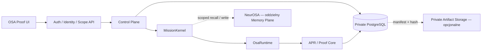

# ADR-PERSISTENCE-001 — Własny trwały Storage Plane (propozycja)

**Status:** `PROPOSED / NOT DEPLOYED / HOST UNKNOWN` · **Data:** 03.11.2026 · **Repo:** `HazEOskA/osa-proof`.

## Cel

Zapewnić trwały, izolowany i audytowalny zapis Team Graph, misji, Run/Proof, artefaktów i historii czatów, niezależny od restartu, skalowania serverless oraz telefonu operatora. Użytkownik **nie posiada na razie potwierdzonego hosta ani instancji PostgreSQL**. Ten dokument nie zatwierdza utworzenia bazy lub zmian infrastruktury.

## Decyzja proponowana

**PostgreSQL na kontrolowanym, przyszłym hoście** jako domyślny transakcyjny Storage Plane; dostawca-neutralny adapter za istniejącymi kontraktami. API łączy się z bazą wewnętrznie, nigdy bezpośrednio z przeglądarki. Możliwy prywatny obiektowy magazyn plików dla ciężkich artefaktów (jego wybór jest osobnym gate).

**Bez nowych silników:** `MissionKernel`, `OsaRuntime`, `ProofCore` i istniejący NeurOSA pozostają jedynymi właścicielami swoich domen.

## Potwierdzony stan implementacji przed zmianą

- `packages/runtime/src/mission-store.ts` definiuje `MissionStore.get(missionId)` i `MissionStore.save(record, expectedRevision)` oraz `persistence: PROCESS_MEMORY | LOCAL_FILESYSTEM`.
- `MemoryMissionStore` i `FileMissionStore` są dostępne; lokalny filesystem działa z rewizją, blokadą pliku i hashem, ale nie jest transakcyjną współdzieloną bazą.
- `api/osa.ts` na Vercel przekazuje `undefined` jako MissionStore, a `ApiState` ma mapy procesu dla Team Graph/Build workspace.
- `apps/api/src/durable.ts` wyłącza plikowy Durable JobStore na Vercel Lambda; lokalny runner wymaga prawdziwie trwałego katalogu i osobnego Workera.
- Historia czatów korzysta z IndexedDB na danym origin urządzenia; nie ma kanonicznego cross-device indeksu.

## Docelowy logiczny schemat danych

| Encja | Dane | Integralność i indeks |
| --- | --- | --- |
| `team_graph_versions` | owner/organization/project/team/version, treść grafu, digest, created_at | unikalny `(organization_id, project_id, team_id, version)`; wersje immutable |
| `workspace_drafts` | owner/project, wersja szkicu, zasoby, updated_at | optimistic revision; bez sekretów, tylko `credential_ref` |
| `mission_records` | `osa.mission.v1`, bieżąca rewizja, canonical digest, status i czasy | unikalny mission scope/id, CAS `WHERE revision=?`, transakcja atomowa |
| `run_index` | run_id, execution_id, mission_id, status, proof_sha256 | indeks pod history + scoped query, nie osobne „źródło prawdy” dla Proof |
| `artifact_manifests` | sha256, media type, size, storage_ref, execution scope | bez publicznych URL i bez cichych zmian artefaktu |
| `chat_sessions` | owner_id, session_id, title, created_at, updated_at, revision | sortowanie `(updated_at DESC, session_id DESC)` |
| `chat_messages` | session_id, message_id, immutable content, execution_id, created_at | unikalny message_id, idempotentny append, paginacja |
| `operation_outbox` | op_id, source_receipt_sha, status, idempotency_key, attempts | ACK wyłącznie po potwierdzeniu; `UNKNOWN` dla spornych side effects |

**Uwaga:** to model logiczny, **nie** migracje wykonane ani zatwierdzone identyfikatory schematu SQL.

## Semantyka MissionStore (must preserve)

1. `save(newRecord, undefined)` = create-only; konflikt ID odrzucany, nigdy update.
2. `save(newRecord, currentRevision)` wykonuje atomowy CAS i zapis `revision = currentRevision+1`.
3. Digest liczony identycznie jak `packages/proof-core/src` nad kanonicznym JSON; brak rozbieżnego formatu serializacji.
4. Gdy baza jest niedostępna, **fail-closed** — nigdy automatyczny fallback na `MemoryMissionStore` dla produkcyjnej misji wymagającej trwałości.
5. Zakończony `MissionRecord` i ProofReceipt nie są reinterpretowane przez mutacje historii lub outbox.
6. Równoległe API: jedna aktualizacja wygrywa; druga otrzymuje `CONFLICT`, bez powtórnej egzekucji side effect.
7. Odczyt historii działa wyłącznie w scope prawdziwej tożsamości, organizacji i projektu.

## Granice bezpieczeństwa i dostępności

- DB dostępna wyłącznie wewnętrznie, przez TLS i oddzielne role: API, Worker, migracje, backup.
- Production Auth + membership/RBAC sprawdzany **przed** query; RLS PostgreSQL dopiero jako dodatkowa kontrola, nie zamiennik identity gate.
- Sekrety poza kodem, logiem i dowodami; w dokumentach tylko nazwy zmiennych i `credential_ref`.
- Prywatne artefakty: manifest i hash w bazie, zawartość w prywatnym magazynie według osobnej polityki dostępu/retencji.
- Backup: kopia bazowa + plan WAL/PITR, szyfrowanie i rzeczywisty restore-test. RPO/RTO pozostają `TBD`, nie należy obiecywać SLA.
- Read-only/Preview nie może uzyskać grantów do produkcyjnej migracji przez model ani prompt.

## Plan migracji i bramki

| Gate | Warunek | Mutacja? |
| --- | --- | --- |
| **G0 Backup** | Odczyt prywatnych sesji w obecnym origin, eksport, liczniki i hashe, weryfikacja kopii | Brak repo; prywatny lokalny backup za zgodą operatora |
| **G1 Contract** | SQL migrations drafted, adapter, tests i plan rollback na kopii repo | Wymaga osobnego zatwierdzenia zmian kodu |
| **G2 Host selection** | Zatwierdzony host, wolumen, sieć, retencja, koszty | Wciąż brak hosta: **BLOCKED** |
| **G3 Isolated E2E** | CAS, restart DB/API, cross-instance, tenant denial, restore-test | Dopiero po osobnej zgodzie na testową infrastrukturę |
| **G4 Preview** | UI historii, cross-device, history links i dowody bez rerun | Osobny approval dla Preview |
| **G5 Production** | Backup, rollout/rollback, bezpieczeństwo, lokalne i CI testy exact SHA | Osobny approval do cutover |

### Minimalny scope plików planowanych do późniejszej implementacji

- `packages/runtime/src/mission-store.ts`: rozszerzenie typów i factory bez przełamywania `get/save`.
- `packages/runtime/src/postgres-mission-store.ts` (**nowy**) + wersjonowane SQL migrations (**nowe**).
- `apps/api/src/index.ts` i `api/osa.ts`: jedna konfiguracja store + autoryzowane listowanie.
- `dashboard-src/src/build.tsx`, `BuildWorkspace.tsx`, `data/data.ts`, `JeversonChat.tsx`, `lib/chat-history.ts`: UI historii i migracja klienta.
- Testy: SQL transaction/CAS, rollback, restart, multi-tenant, browser history migration, duplicate-write refusal.

## Jawne decyzje nadal otwarte

- Host fizyczny / VM / wybrana chmura: **UNKNOWN**.
- Dostawca storage / istniejąca baza / wolumen: **UNKNOWN**.
- Backup target, RPO, RTO, retencja, koszty: **UNKNOWN**.
- Produkcyjne tożsamości i role: **REQUIRES ACCEPTANCE**.
- Sposób migracji prywatnych danych użytkownika: **AWAITING EXPLICIT APPROVAL**.

**Control:** `TARGET = HazEOskA/osa-proof` · `SCOPE = storage/history docs + architecture` · `STATUS = PROPOSAL ONLY` · brak provisioningu, brak migracji, brak deploy.
